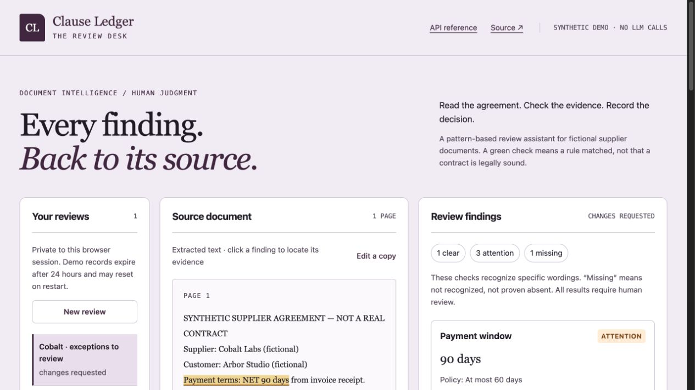
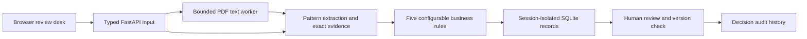

# Clause Ledger

**An evidence-first supplier-document review desk: extract supported terms, check configurable rules, and record a human decision.**

Paste text or upload a text-based PDF. Every recognized finding points to the exact source passage and page. Conflicting values are flagged rather than silently selecting a favourable clause. A reviewer can approve, request changes, or reject, with a versioned audit event.

**Rebuild status:** independent Python application with an offline demonstration and optional configured model extraction. Provider-boundary tests use mocks; no live model-quality evaluation is claimed.



## What problem does this solve?

Operations teams repeatedly check whether supplier documents include expected payment, availability, breach-notification, termination and audit wording. Clause Ledger makes that first pass consistent and inspectable. It does not decide legal compliance or replace a qualified reviewer.

## Try locally

```bash
python -m venv .venv
source .venv/bin/activate
pip install -r requirements.txt
uvicorn clause_ledger.app:app --host 127.0.0.1 --port 8000
```

Open `http://127.0.0.1:8000`. `/docs` provides the local API reference and `/openapi.json` the machine-readable contract. No provider key or paid service is needed.

## A recruiter's three-minute walkthrough

1. Load the standard synthetic supplier example and run its review.
2. Open a finding and check that its quote matches the source text.
3. Load the conflicting-terms example. Observe that the tool does not choose one payment window automatically.
4. Adjust a policy threshold, run a new review, and compare the outcome.
5. Record a human decision with a note. The review version and event history change; replaying a stale version is refused.

## Architecture and data flow



`clause_ledger/analysis.py` contains the explainable rules. `storage.py` owns parameterized persistence and review versions. `app.py` handles API contracts, session boundaries and uploads. The frontend uses local assets and displays missing information rather than generating unsupported clauses.

## What is implemented, and what is not?

- **Implemented:** text/PDF ingestion, source offsets/page citations, configurable thresholds, conflicting-value detection, session isolation, review history, stale-update rejection and per-session quotas.
- **Default engine:** deterministic patterns, without external calls. Optional semantic mode uses a configured OpenAI-compatible provider and validates its output locally. No model accuracy is claimed.
- **Missing wording:** means no supported phrase was recognized; it does not prove the clause is absent. A passing rule does not establish legal adequacy.
- **Negation:** obvious negative words on the same source line flag a finding for attention. This conservative heuristic may overflag unrelated wording and is not general semantic interpretation.
- **PDF boundary:** at most 1 MiB, ten pages and 50,000 extracted characters. Parsing runs in a bounded subprocess with a wall deadline and POSIX limits where supported. Scanned PDFs need OCR, which is not implemented.
- **Identity:** a random HttpOnly browser session separates demo records. Reviewer names are self-declared aliases, not authenticated enterprise identities.
- **Storage:** SQLite survives app recreation when `CLAUSE_DB` points to a retained file. Default/free-hosting storage is ephemeral. Do not upload sensitive documents to the public demonstration.
- **Scale:** this is a bounded single-service portfolio application, not a validated enterprise service.

## Verification

```bash
pip install -e '.[dev]'
python -m pytest -q
ruff check clause_ledger tests
python -m clause_ledger.evaluate --check
```

Twenty-five local tests pass. The original twelve cover actual review transitions, cross-session access, exact evidence, policy changes, conflicting values, negation warnings, a valid two-page PDF, invalid/oversized/encrypted/over-page-limit PDFs, restart persistence, quotas, expiry, and concurrent stale-update rejection. [Evaluation](docs/evaluation.json) reports agreement on six authored rule fixtures. Three fixtures are also UI examples; this is a regression check, not an independent NLP benchmark.

## Deployment

`render.yaml` defines a free Python service. `COOKIE_SECURE=true` is set for HTTPS deployment. For local HTTP, leave it unset. `Dockerfile` runs the same API. Hosted smoke verification covers pages/assets, conflict detection, cross-session isolation, human review/version history, stale-update refusal, and deleting the verifier's own synthetic review.

## Ownership and interview topics

Original implementation for Deepak Gangwar's portfolio, developed with AI assistance. VendorGuard inspired the supplier-review workflow; no upstream code, prompts, rulebook or assets were copied. The original team's award is not this project's achievement. See the [source investigation](docs/reference-analysis.md).

Useful technical discussion: when deterministic extraction is preferable to model generation; evidence spans versus summaries; atomic version checks; browser-session isolation; input/resource limits; replacing the baseline with a separately evaluated semantic extractor.

Skills demonstrated: Python, REST APIs, structured text processing, SQL persistence, validation, automation, testing, Git/CI, documentation and human-review workflow design. Source code uses the MIT [license](LICENSE).

## Original project study

See the [upstream project study](docs/upstream-study.md) for the original architecture, authorship, setup requirements and limitations. It describes a separate upstream reference, not this repository’s deployed application.

## Optional source-checked AI extraction

Set `CLAUSE_LLM_API_KEY`, `CLAUSE_LLM_MODEL` and a long random `CLAUSE_LLM_ACCESS_TOKEN` on the server. Optionally set `CLAUSE_LLM_BASE_URL` (default `https://api.openai.com/v1`; HTTPS required except localhost). Restart the server, enter the operator access token in the password field (or use the `X-AI-Token` API header), then explicitly choose configured AI extraction in the form or send `engine: "semantic"` in the text API. The PDF endpoint accepts the same form field. Selecting this mode sends document text to the configured provider and can incur charges. Never put keys in the browser or repository.

The provider proposes five typed fields. Every quote must be a unique exact substring of its cited page, and numeric values must occur in that quote. Duplicate keys, invented quotes, invalid pages, unsupported types and malformed responses fail without saving a review. Local code applies the policy; the model never approves a contract. Known conflicting values from the offline extractor, same-line negation (even outside a truncated quote), and uncalibrated confidence below 0.8 force attention. Quote completeness and semantic interpretation are not proven by string matching; all results require review.

Provider-boundary tests use HTTP mock transports: valid evidence, invented values/quotes, invalid pages and confidence, boolean confusion, negation, redacted outage errors and unconfigured requests. These demonstrate validation behavior, not real-provider quality or an improvement over VendorGuard. The source study remains credited; this is an independently implemented Python application.

AI requests without the operator token are rejected before the provider is called. The browser clears the token after each analysis request and never stores it in localStorage. This shared token is a bounded portfolio control, not enterprise authentication; production still needs authenticated users, per-user authorization and rate limits.

## Demo and interview walkthrough

[Open the demo](https://dg-clause-ledger.onrender.com) · [Five-minute walkthrough](docs/DEMO.md). Free hosting can sleep; instance-local demo records may reset. External-provider and Jira modes are disabled unless configured and authorized.
